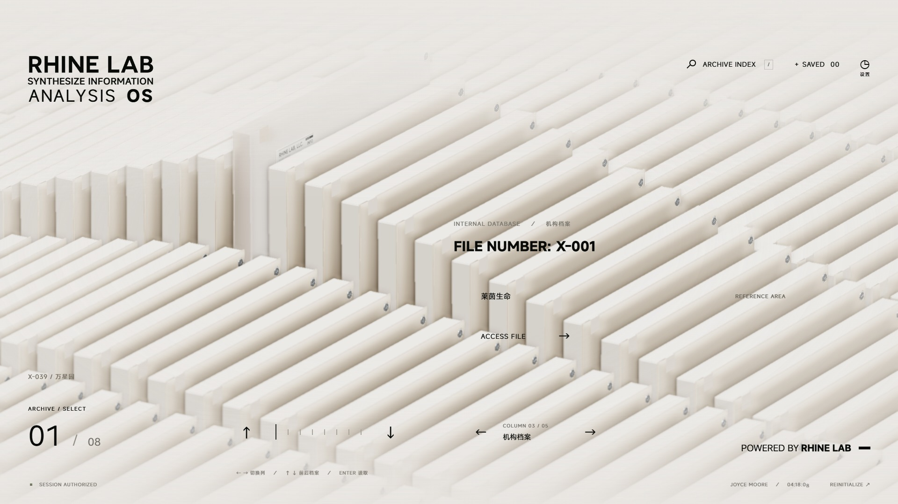
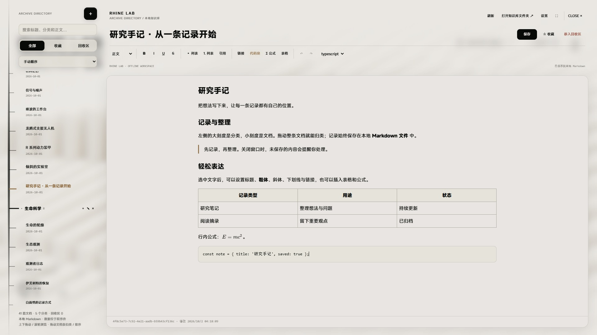
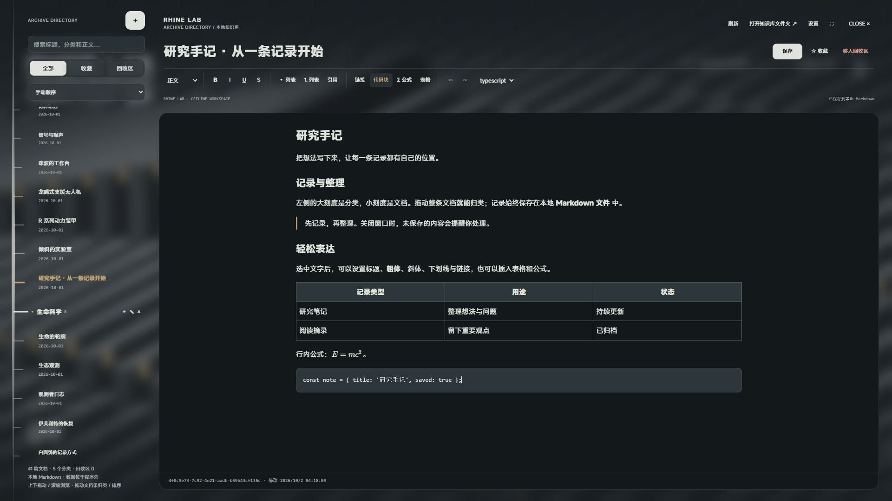
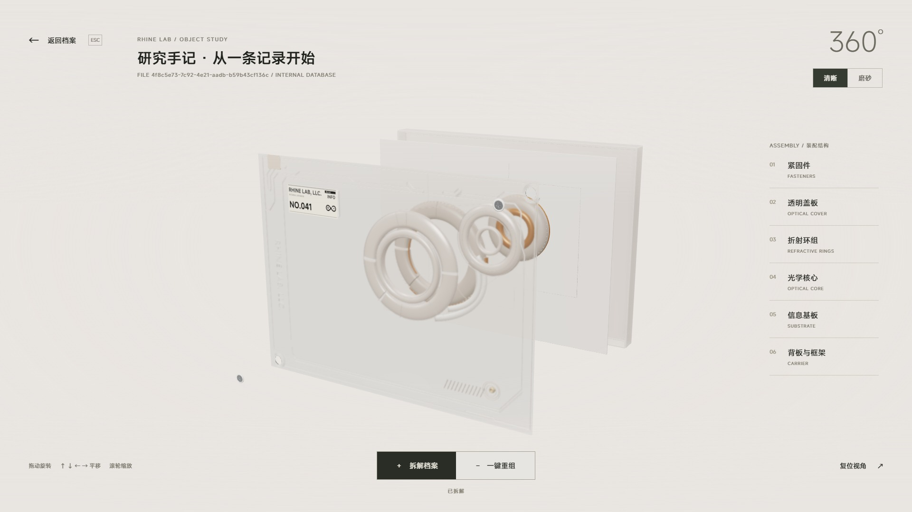
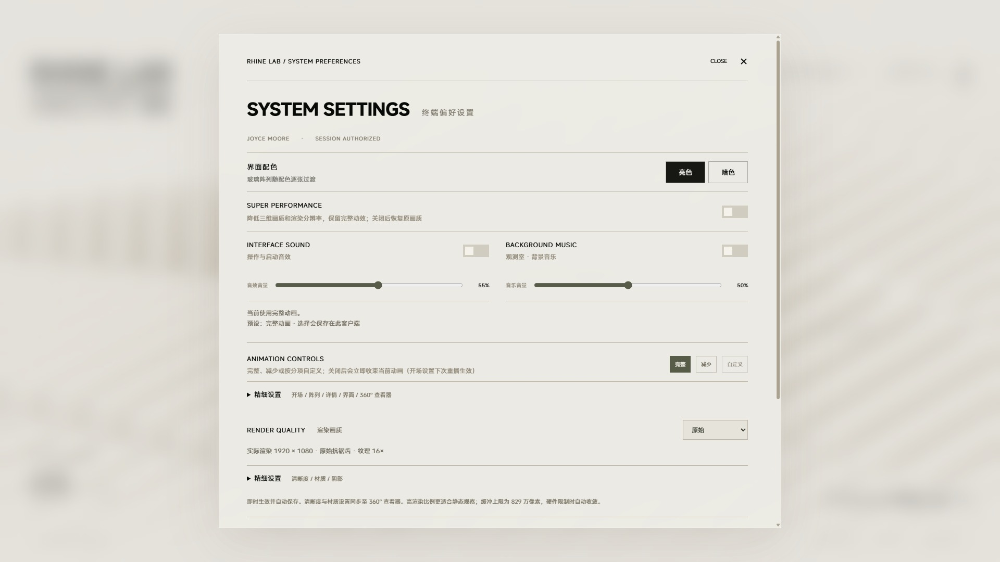

# RHINE LAB 本地知识库

**把莱茵生命的三维终端，变成可以阅读、编辑和整理的本地知识库。**

**[下载 Windows 客户端 →](https://github.com/realhc/RhineLabUI-KM/releases/latest)** | [使用教程](#快速开始) | [操作说明](#操作说明) | [源码开发](docs/DEVELOPMENT.md)



Rhine Lab 是一个 Windows 便携客户端。实时渲染的档案阵列、玻璃解密与模型查看器围绕本地 Markdown 文档工作；知识库用全屏磨砂玻璃打开，左侧刻度目录、右上工具区与右下正文彼此独立。

文档保存在程序旁的文件夹中。无需账户、API Key、开发服务器或另外安装 Node.js，解压即可离线使用。

**当前正式版是 [1.1.0](https://github.com/realhc/RhineLabUI-KM/releases/tag/v1.1.0)**，包含搜索增强、可选 AI 助手和定时文档。AI 能力需要自行配置兼容的模型接口，未接入时基础功能与关键词搜索照常使用。

**当前源码为 1.2.0-preview.1**，新增模型图片、正文图片和关系图谱，已生成本地预览程序，暂未发布 GitHub Release。下文标注“当前源码”的功能属于此预览版。[版本对应与本地包目录](docs/VERSIONS.md)

## 快速开始

1. 从 [Releases](https://github.com/realhc/RhineLabUI-KM/releases/latest) 下载 **RhineLab-win32-x64-1.1.0.zip**，完整解压到有写入权限的文件夹。
2. 运行其中的 **RhineLab.exe**。保留同目录的 `resources` 等运行文件，不能只复制 EXE。
3. 等待资源就绪，点击进入；可以点击 `ENTER SYSTEM` 跳过开场。
4. 点击 `ARCHIVE INDEX` 打开知识库，或从档案详情进入对应文档。

首次启动会建立 `RhineLabData`，导入 40 份示例档案。删除全部文档后也不会重新导入。当前提供 Windows x64 便携版，尚未签名；发布附件同时提供 SHA-256 校验清单。

## 界面与功能

### 刻度目录与玻璃工作区

目录像刻在玻璃上：主轴贯穿窗口，分类为大刻度，文档为小刻度。点击加号命名并创建分类或文档；分类可折叠，整条文档都能拖入分类或调整顺序。删除分类会保留文档，删除文档也不会删除分类。



目录支持滚轮和空白区域上下拖动，松手后按速度减速。玻璃层与三块区域错峰显现，文档切换轻微淡入，选中刻度缓慢呼吸；编辑和拖动时收束持续动效。系统和应用的减少动态效果设置均生效。

### 排版阅读与直接编辑

阅读与编辑使用同一份排版正文。按 **E** 或点击“编辑”进入编辑，**Ctrl+S** 或“保存”写入磁盘并继续编辑；切换其他文档后恢复阅读状态。

- 一级到四级标题、正文、粗体、斜体、下划线与删除线。
- 链接、引用、列表、代码块，以及表格的行列操作。
- 离线 LaTeX 行内公式与独立公式。
- 撤销/重做、全文检索、收藏、手动排序与回收区。

源 Markdown 保存在本地文件中，正文不显示源码分栏。外部修改与未保存草稿冲突时，可以取消、另存副本或重载磁盘版本。

### 正文图片（当前源码）

将 PNG/JPEG 图片拖到正文中的目标位置即可插入，也可以在编辑时粘贴剪贴板图片，或点击工具栏“图片”。按 Ctrl+S 保存，支持撤销和重做；导入过程中继续输入也会保持插入位置。每次最多 10 张，单张不超过 20 MB、3200 万像素，单边不超过 16384 像素，保留原始文件。回收区中的文档只读。

Markdown 使用标准 `` 相对路径。图片存于知识库中，移动原图片不会影响阅读；已有网络图片或知识库以外的本机路径仍只显示占位文字。

### 关系图谱（当前源码）

点击知识库顶部的“关系图谱”，查看文档之间的链接。每篇文档是一个节点，连线来自正文中的知识库文档链接。悬停可突出相邻文档，点击节点打开文档；可搜索、隐藏孤点、拖动画布和节点，滚轮缩放，点击“适应画面”复位。回收区文档不进入图谱。

编辑时选中文字并点击“链接”，可以从“关联文档”选择目标；保存后生成指向目标稳定 ID 的标准 Markdown 链接，重命名目标文档不会断开关系。已有的 `[[文档标题]]` 或同目录 Markdown 文档链接也可形成关系；标题重名时请使用“关联文档”选择目标。

### 明暗配色

暖灰底、细线与杏金强调延续到整个客户端。暗色使用烟灰玻璃和琥珀信号，字体、布局与编辑工具保持一致。



### 搜索增强

左侧搜索支持多个关键词、带引号的词组、中文与英文匹配；命中结果提供上下文摘要和高亮。输入查询后，可以限定分类、按相关性查看结果，也可以继续使用原有标题、最近修改或手动排序。选中文档后，正文中的命中会高亮，使用 ↑ / ↓ 在命中处定位；进入编辑时停止高亮，不改动正文与撤销记录。

关键词搜索离线运行。配置向量模型后，可点击“语义补充”查找意思相近的资料，原有关键词命中仍保留；连接失败不影响普通搜索。首次语义查询需要建立索引，随后按文档内容变化增量更新。

### 可选 AI 与定时文档

点击知识库右上的 **AI** 打开助手，选择“接入设置”，填写服务商的 API Base URL、对话模型和可选向量模型。填写 API Key 后保存，再测试连接。接口需兼容 Chat Completions；让模型操作知识库需要支持工具调用。本机兼容接口无需密钥时可以留空。

助手可以搜索、读取、总结文档，并按要求整理知识库。默认只读；勾选“允许本次写入”后，才可创建、修改、移入回收区、恢复文档和管理分类。修改必须基于当前修订，未保存草稿会受到保护；已完成的操作不会因停止生成而自动撤销。远程服务会收到请求涉及的内容，API Key 由系统加密保存，不放入浏览器偏好或 Git。

在“定时文档”中填写编写要求、资料范围、存入分类和时间，支持指定时间一次、每天或固定间隔。也可让助手创建任务。任务只生成新文档，支持暂停、修改、移除和立即运行。**程序运行时执行，关闭期间错过的任务重开后最多补跑一次；不会在程序关闭时后台唤醒电脑。**

“本机知识库 API”用于让外部 AI 工具读取能力指引并调用知识库工具，默认关闭，启用后仅监听 127.0.0.1，使用独立令牌。写入权限另行开启；即使没有配置聊天模型，本机工具接口仍可使用。[接入教程、工具清单与 AI 指引](docs/AI-API.md)

### 三维阵列、解密与模型查看器

阵列可循环浏览，档案竖直抽取后由镜头靠近并转正，玻璃与正文同步解密。独立查看器支持旋转、缩放、平移、清晰/磨砂切换、六组拆解与重组。



分类和文档的顺序映射到阵列的列与模型，完整知识库没有 40 篇上限。即使删空知识库，三维阵列仍然存在。启动及跳过开场的图形异常具有恢复入口；图形恢复不重载正在编辑的草稿。

### 模型图片（当前源码）

在知识库中选中文档，点击 **模型图片**，即可选择本地 PNG 或 JPEG 图片，贴在该文档的三维模型盖板上；阵列、抽取详情和 360° 查看器同步显示。图片保持原比例完整显示，不拉伸；未设置图片的模型保持原样。再次点击 **更换模型图片** 可以替换，**移除图片** 恢复原模型。回收区中的文档只读，恢复后可继续修改图片。

导入文件不超过 20 MB、3200 万像素，单边不超过 16384 像素；程序会等比缩小至最长边 1024 像素并保存为 PNG。图片复制到知识库后，移动原始图片不会影响显示。存在未保存正文时，会先提示保存、放弃或取消；取消图片选择不会替换已有图片。

### 声音、画质与动效

设置提供音效/音乐音量、亮暗配色、画质、全屏及完整/减少/自定义动画。超级性能模式与减少动画分别控制；关闭性能模式会恢复已保存的画质。



知识库进退场由 `SURFACE TRANSITIONS` 控制，文档切换由 `DOCUMENT REVEAL` 控制，刻度呼吸由 `IDLE MOTION` 控制，目录惯性由 `DRAG MOMENTUM` 控制。

## 操作说明

模型图片、正文图片和关系图谱操作需使用当前源码构建的预览版。

| 操作 | 效果 |
| --- | --- |
| 阵列中 `← / →`、`↑ / ↓` | 切换列和档案，支持循环 |
| 拖动阵列 / 滚轮 | 浏览档案，按实际速度滑行 |
| `Enter` / `ACCESS FILE` | 打开当前档案 |
| `ARCHIVE INDEX` | 打开知识库 |
| 知识库左侧 `＋` | 命名并创建分类或文档 |
| 拖动整条文档 | 归类或调整手动顺序 |
| 文档工具栏 **模型图片** / **移除图片** | 添加、更换或移除当前文档的模型图片 |
| 知识库顶部 **关系图谱** | 查看并打开有关联的文档 |
| `E` | 当前文档进入编辑 |
| `Ctrl+S` | 保存，继续编辑 |
| `Ctrl+N` / `Ctrl+F` | 新建文档 / 搜索 |
| `F11` / `Esc` | 切换全屏 / 退出全屏或关闭当前界面 |

删除文档先移入回收区，可以恢复；永久删除需要再次确认。切换文档、关闭知识库或退出程序时，未保存内容会提示保存、放弃或取消。

## 本地文件、备份与升级

```text
RhineLab/
  RhineLab.exe
  resources/
  RhineLabData/
    documents/<文档ID>.md
    assets/model-images/
    assets/document-images/
    .trash/
    backups/
```

每篇文档是 UTF-8 Markdown，文件头记录稳定 ID、标题、分类、顺序和时间。修改标题不改变文件名。其他 Markdown 编辑器可以读取这些文件；客户端会检测外部变化，也提供手动刷新。

预览版的模型图片保存在 `RhineLabData/assets/model-images/`，文档文件头记录图片引用；正文图片保存在 `RhineLabData/assets/document-images/`，正文使用相对路径引用。备份或迁移时请保留整个 `RhineLabData`，以便同时保留正文和图片。删除正文中的图片不会立即删除磁盘文件，以保留撤销、回收恢复和备份所需的图片。

迁移时先关闭程序，再复制整个程序文件夹。升级时先备份 `RhineLabData`，用新发行文件替换程序，**保留原来的 `RhineLabData`**。不要用空知识库覆盖它。设置与收藏可以独立导入/导出，但其 JSON 不包含文档正文。

演示文档位于 [content/desktop-demos](content/desktop-demos)，分别展示标题与文字格式、表格、代码、公式和快捷键。[详细数据说明](docs/DESKTOP.md)

## 项目路径与技术栈

以下路径均相对于仓库根目录。

| 路径 | 用途 |
| --- | --- |
| `desktop/` | Electron 主进程、受限桥接与文件仓库 |
| `src/` | 三维终端、知识库与富文本编辑器 |
| `public/` | 客户端模型、字体、配乐及许可 |
| `content/` | 初始档案与编辑器演示 |
| `art/` | 模型生成脚本及 Blender 源工程 |
| `scripts/` | 开发、资源制作与打包工具 |
| `tests/` | 单元、文件仓库及实际客户端检查 |
| `docs/` | 使用、开发与版本说明 |
| `verification/` | 保留的验收结果与截图 |
| `release/` | 本地的两个正式版归档与当前预览版，不进入 Git |
| `local/` | 本机备注和数据备份，不进入 Git |
| `RhineLabData/` | 开发模式的个人知识库，不进入 Git |
| `AGENT.md` | 面向 AI 的开发边界、验证和下一步路线 |

使用 **Electron + Electron Forge、TypeScript、Three.js、Vite、Tiptap/ProseMirror、Markdown-it 和 KaTeX**。动画由原生 DOM/SVG、Web Animations 与三维时间轴驱动；文档使用文件仓库和原子写入，不依赖云端数据库。

开发需要 Node.js 22.12 或更新版本：

```powershell
git clone https://github.com/realhc/RhineLabUI-KM.git
cd RhineLabUI-KM
npm.cmd ci
npm.cmd run dev:desktop
```

生成便携客户端：

```powershell
npm.cmd run package:desktop
npm.cmd run check:desktop:package
```

目录地图与构建流程见 [开发说明](docs/DEVELOPMENT.md)，验证入口见 [tests/README.md](tests/README.md)，维护边界见 [AGENT.md](AGENT.md)。截图来自实际客户端的隔离示例知识库，采集说明见 [docs/media/README.md](docs/media/README.md)。

## 原作者与许可

本项目基于 **[LBEILC / RhineLabUI](https://github.com/LBEILC/RhineLabUI)** 衍生开发，感谢原作者的终端视觉、三维模型、开场、声音及相关实现。本仓库由 **[realhc / Hong Chang](https://github.com/realhc)** 独立维护，新增本地知识库、排版编辑与桌面文件管理。

保留原作者 **Copyright (c) 2026 LBEILC** 与 [MIT License](LICENSE)。原作者有权授权的代码、模型、Blender 工程、原创配乐和素材依照该许可分发；修改并未取消第三方版权。MiSans、依赖库及 Electron/Chromium 保留各自许可，发行包附带第三方声明。

本项目是《明日方舟》莱茵生命终端视觉的非官方衍生项目，与官方制作方无隶属关系。原作名称、标志、设定、影像及音频采样的权利归各自权利人所有，不在本项目 MIT 授权范围内。独立许可的 Novecento 字体不进入便携包。[资源与分发说明](docs/DESKTOP-LICENSES.md)
