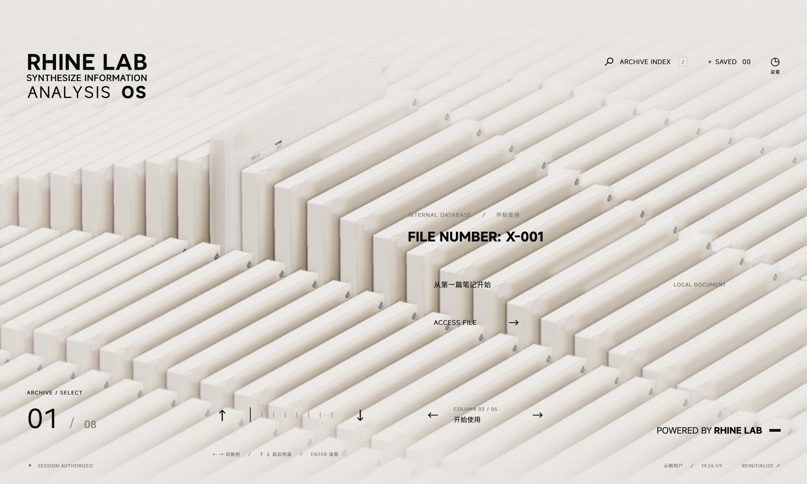
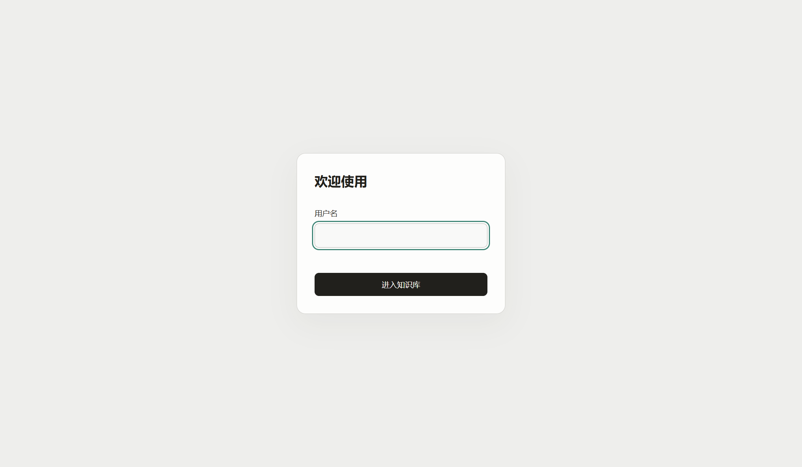
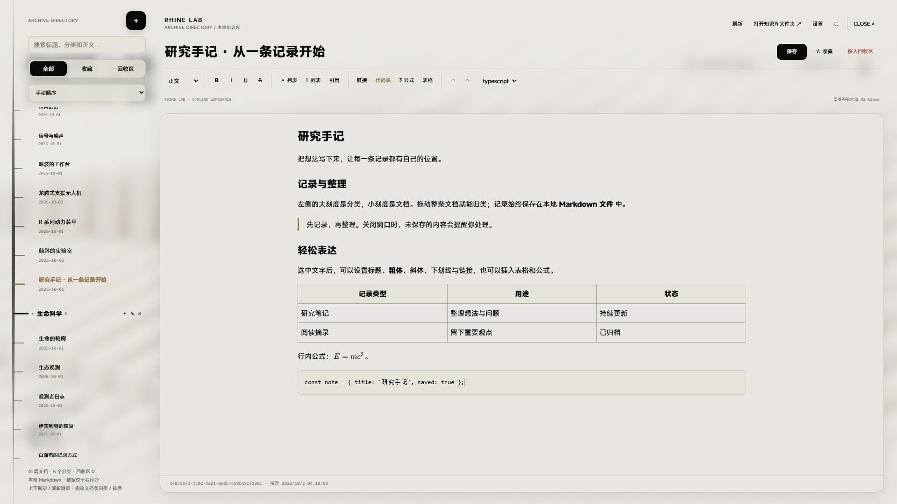
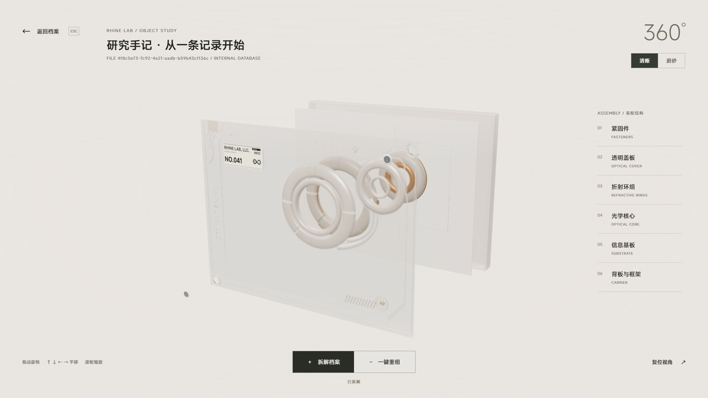

# RHINE LAB 本地知识库

**用三维档案终端阅读、编辑和整理本地 Markdown。**

**[下载 Windows 客户端 →](https://github.com/realhc/RhineLabUI-KM/releases/tag/v1.2.3)** | [快速开始](#快速开始) | [操作说明](#操作说明) | [源码开发](docs/DEVELOPMENT.md)



Rhine Lab 是 Windows x64 便携客户端。三维档案阵列、玻璃解密与模型查看器连接本地文档；打开知识库后，可直接阅读排版正文、编辑笔记、整理分类和查看文档关系。

文档保存在程序旁的 `RhineLabData` 文件夹中，基础功能可离线使用。首次只需填写一个本地用户名，无需密码、联网注册、API Key 或另外安装 Node.js。

当前正式版为 **[1.2.3](https://github.com/realhc/RhineLabUI-KM/releases/tag/v1.2.3)**，支持首次填写用户名并在本机记住，启动身份、界面与访问日志使用该名字。发布包不预置用户名。

[1.2.3 更新说明](docs/RELEASE-1.2.3.md) | [版本与本地归档](docs/VERSIONS.md)

## 快速开始



1. 下载 **RhineLab-win32-x64-1.2.3.zip**，完整解压到有写入权限的文件夹。
2. 运行 **RhineLab.exe**。保留同目录的 `resources` 等运行文件，不能只复制 EXE。
3. 首次填写用户名，点击“进入知识库”。用户名最多 32 个字符，支持中文和空格；下次启动自动沿用。
4. 等待资源就绪后进入终端；点击 `ENTER SYSTEM` 可跳过开场。
5. 点击 `ARCHIVE INDEX` 打开知识库，或从模型详情进入对应文档。

全新空知识库会自动提供 6 篇教程，涵盖创建分类、编辑与图片、阅读关联、历史、外观和备份/AI。已经使用过的知识库删空后不会重复导入。发行包不包含个人笔记。

## 阅读、编辑与整理

### 分类与文档

左侧目录的分类是大刻度，文档是小刻度。点击 `＋` 创建分类或文档；拖动整条文档可归类或调整手动顺序。分类可以折叠，移除分类会保留其中的文档。文档先移入回收区，可以恢复。



点击“编辑”或按 **E** 开始编辑，**Ctrl+S** 保存后继续编辑；切换文档恢复阅读状态。支持标题、文字格式、列表、引用、代码块、表格和离线 LaTeX 公式，并保留每篇文档独立的撤销历史。外部文件变化与未保存草稿冲突时，可取消、另存副本或重载磁盘版本。

### 图片

编辑正文时，可拖入或粘贴 PNG/JPEG，也可使用格式工具栏的“图片”。按 Ctrl+S 保存后，正文使用标准 Markdown 相对引用，图片存入知识库。每次最多 10 张，单张不超过 20 MB、3200 万像素，单边不超过 16384 像素。原始文件保留，移动导入前的图片不影响阅读。

文档工具区的“模型图片”用于该文档的三维模型，与正文插图独立。图片保持比例完整显示，位于磨砂盖板下，阵列、详情与查看器同步；可选原图、双色、网点或线稿。没有自选图片时，程序按分类和稳定编号生成等值线、流场或线路封面。

### 阅读与搜索

“文内大纲”可跳到章节；“快速切换”或 **Ctrl+P** 可搜索标题、分类和编号。使用返回/前进按钮或 **Alt+← / Alt+→** 沿阅读路径往返，恢复本次会话的阅读位置。

左侧搜索离线检索标题、分类与正文，支持多关键词、引号词组、中文与英文匹配、分类范围和相关性排序。正文命中可逐项定位；进入编辑后停止高亮，不改动正文或撤销记录。配置向量模型后，可按需使用“语义补充”，普通搜索仍可独立使用。

### 链接、图谱与历史

编辑时输入 **[[** 选择关联文档，或通过“链接”工具插入文档内链。链接使用稳定 ID，重命名不会断开；标题重名时请明确选择目标。

“文档关系”展示引用来源、引用去向和未链接提及，并可查看一层或两层局部图谱。顶部“关系图谱”展示整库链接，支持搜索、拖动、缩放及点击节点打开文档；回收区文档不参与关系计算。

“历史”可浏览旧修订、比较差异、恢复为新修订或另存副本。恢复前保留当前版本，未保存草稿和外部修订冲突仍受保护。文档历史不替代整个知识库的备份。

## 三维终端与个性化

### 阵列与模型查看器

阵列支持循环浏览和惯性拖动，档案竖直抽取后由镜头靠近、转正。点击 **ACCESS FILE** 后，盖板与简介共同解密，概述页签、面板标签和正文标题一起解除遮蔽。独立查看器支持旋转、缩放、平移、清晰/磨砂切换，以及六组结构拆解与重组。



文档数量没有 40 篇上限，空知识库也保留三维阵列。模型主体结构、大小和图片窗口保持固定，外观设置只改变表面显示。

### 设置

设置分为 **通用、外观、声音、动态、画质、数据** 六页，内容独立滚动。动态和画质的全部选项直接展示。

| 项目 | 用途 |
| --- | --- |
| 通用中的“用户名” | 修改程序内的身份显示，保存并重新载入后生效 |
| 通用中的“应用内名称” | 修改终端、知识库和模型上的应用名称，外部程序文件与系统窗口名称不变 |
| 外观 | 原色、统一色、多彩调色盘，原始/缎面/金属/珠光镀层，颜色强度与收藏专属色 |
| 文档工具区的“模型颜色” | 为单篇文档指定颜色；“跟随全局”可移除指定色 |
| 声音、动态、画质 | 音效和音乐音量、完整/减少/自定义动态，以及渲染质量与超级性能模式 |
| 数据 | 导入或导出设置与收藏，查看备份与字体许可入口 |

单篇模型颜色优先于收藏色和全局配色，强度仍由全局设置控制。阵列、详情、返回副本与模型查看器同步显示；标签和图片不随模型着色。全局外观恢复默认会保留单篇指定色。

用户名、应用内名称、外观和收藏都保存在本机偏好中，可随设置文件迁移。用户名用于本地显示，无需密码或在线账户。导入旧设置文件后若没有用户名，程序会在重新载入时请你填写。

## 可选 AI

基础知识库、关键词搜索、图谱和三维终端不需要 AI。点击知识库右上的 **AI**，在“接入设置”填写兼容接口地址、对话模型和可选向量模型，保存后测试连接。接口需兼容 Chat Completions；调用知识库工具需要模型支持工具调用。

助手可搜索、读取、总结文档。默认只读；勾选“允许本次写入”后，才可创建、修改、移入回收区、恢复文档和管理分类。修改基于当前修订，未保存草稿受到保护。远程服务会收到请求涉及的内容，API Key 由系统加密保存，不写入浏览器偏好或 Git。

“定时文档”支持指定时间一次、每天或固定间隔，提供暂停、修改、移除和立即运行。任务只生成新文档，**仅在程序运行时执行**；关闭期间错过的任务重开后最多补跑一次，不会后台唤醒电脑。

“本机知识库 API”默认关闭，启用后只监听 `127.0.0.1`，使用独立令牌，写入权限另行开启。即使未配置聊天模型，本机工具接口仍可使用。[AI 接入、工具清单与使用指引](docs/AI-API.md)

## 操作说明

| 操作 | 效果 |
| --- | --- |
| 阵列中 `← / →`、`↑ / ↓` | 切换分类和档案 |
| 拖动阵列 / 滚轮 | 浏览档案 |
| `Enter` / `ACCESS FILE` | 读取当前档案 |
| `ARCHIVE INDEX` | 打开知识库 |
| 目录 `＋` / 拖动整条文档 | 新建 / 归类与排序 |
| `E` / `Ctrl+S` | 编辑 / 保存并继续编辑 |
| `Ctrl+P` / `Alt+← / Alt+→` | 快速切换 / 阅读前进后退 |
| `Ctrl+N` / `Ctrl+F` | 新建文档 / 搜索 |
| `F11` / `Esc` | 切换全屏 / 退出全屏或关闭当前界面 |

切换文档、关闭知识库或退出程序时，未保存内容会提示保存、放弃或取消。永久删除回收区文档需要再次确认。

## 数据、备份与升级

```text
RhineLab/
  RhineLab.exe
  resources/
  RhineLabData/
    documents/<文档ID>.md
    assets/model-images/
    assets/document-images/
    .trash/
    backups/
```

每篇文档是 UTF-8 Markdown，文件头保存稳定 ID、标题、分类、顺序和时间。改标题不改文件名。其他 Markdown 编辑器可以读取文件，客户端会检测外部变化，也提供手动刷新。

**备份文档：** 先保存并关闭程序，再复制整个 `RhineLabData`，同时保留图片、历史、回收区和目录信息。不要只复制 `documents`。移除正文中的图片不会立即删除磁盘资产，以保留撤销和历史恢复所需的内容。

**迁移偏好：** 在设置“数据”页导出设置与收藏，在另一台电脑导入。该 JSON 包含用户名、应用内名称、配色与收藏编号，不包含 Markdown、图片或文档历史。

**升级程序：** 先备份 `RhineLabData`，再用新发行文件替换程序，保留原知识库。发布 ZIP 不预置用户名或个人文档；本机已有用户名和设置继续沿用。当前提供未签名的 Windows x64 便携版，附件提供 SHA-256 校验清单。

[编辑演示](content/desktop-demos) | [详细数据说明](docs/DESKTOP.md) | [资源与分发说明](docs/DESKTOP-LICENSES.md)

## 源码与维护

使用 **Electron / Electron Forge、TypeScript、Three.js、Vite、Tiptap / ProseMirror、Markdown-it 和 KaTeX**。动画由原生 DOM/SVG、Web Animations 与三维时间轴驱动；文档使用原子文件仓库。

开发需要 Node.js 22.12 或更新版本：

```powershell
git clone https://github.com/realhc/RhineLabUI-KM.git
cd RhineLabUI-KM
npm.cmd ci
npm.cmd run dev:desktop
```

生成便携客户端：

```powershell
npm.cmd run package:desktop
npm.cmd run check:desktop:package
```

`desktop/` 管理窗口、桥接与文件仓库，`src/` 承载界面和三维终端，`content/` 保存首次使用教程，`public/` 保存模型、字体、配乐与许可。`release/` 是本地发行归档，`local/` 保存本机备注和备份，两者均不进入 Git。

[开发说明](docs/DEVELOPMENT.md) | [检查入口](tests/README.md) | [维护交接与后续建议](HANDOFF.md) | [AI 开发边界](AGENT.md)

截图来自实际客户端的示例知识库，本轮首启与阵列截图见 [1.2.3 验收记录](verification/release-1.2.3/DELIVERY.md)，其余采集说明见 [docs/media/README.md](docs/media/README.md)。

## 原作者与许可

本项目基于 **[LBEILC / RhineLabUI](https://github.com/LBEILC/RhineLabUI)** 衍生开发，保留原作者的终端视觉、模型、开场、声音及相关实现。本仓库由 **[realhc / Hong Chang](https://github.com/realhc)** 独立维护，新增本地知识库、排版编辑与桌面文件管理。

保留 **Copyright (c) 2026 LBEILC** 与 [MIT License](LICENSE)。原作者有权授权的代码、模型、Blender 工程、原创配乐和素材依照该许可分发；MiSans、依赖库及 Electron/Chromium 保留各自许可，发行包附带第三方声明。独立许可的 Novecento 字体不进入便携包。

这是《明日方舟》莱茵生命终端视觉的非官方衍生项目，与官方制作方无隶属关系。原作名称、标志、设定、影像及音频采样的权利归各自权利人所有，不在本项目 MIT 授权范围内。
